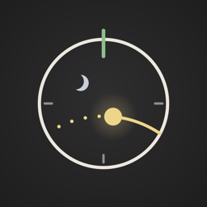

  

<h1 align="center">Meridian Support</h1>

  Help with Meridian, and how to get in touch. 
  <a href="https://chrismahlke.github.io/meridian/">Website</a> ·
  <a href="https://chrismahlke.github.io/meridian/privacy/">Privacy</a> ·
  <a href="https://github.com/ChrisMahlke/meridian/issues/new?template=report-a-problem.yml">Report a problem</a>

---

Meridian puts the sun, the moon, your heading, and the time on one quiet dial, for iPhone, iPad, and Apple Watch.

This repository is the support channel for the app. To report a problem, suggest something, or ask a question, [open an issue](https://github.com/ChrisMahlke/meridian/issues/new/choose) with your device, its iOS or watchOS version, and what you expected to see. The [support page](https://chrismahlke.github.io/meridian/support/) answers common questions.

---

  © 2026 M10 LLC

